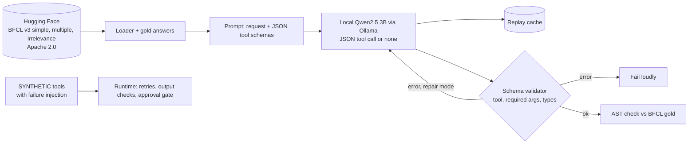
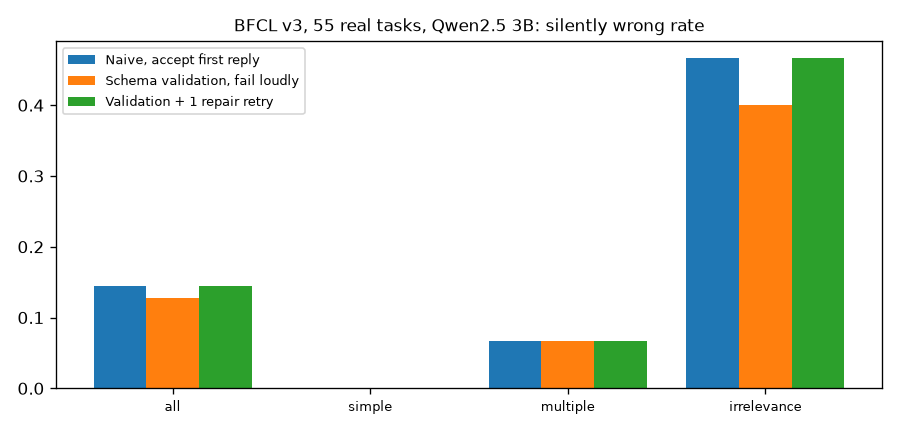
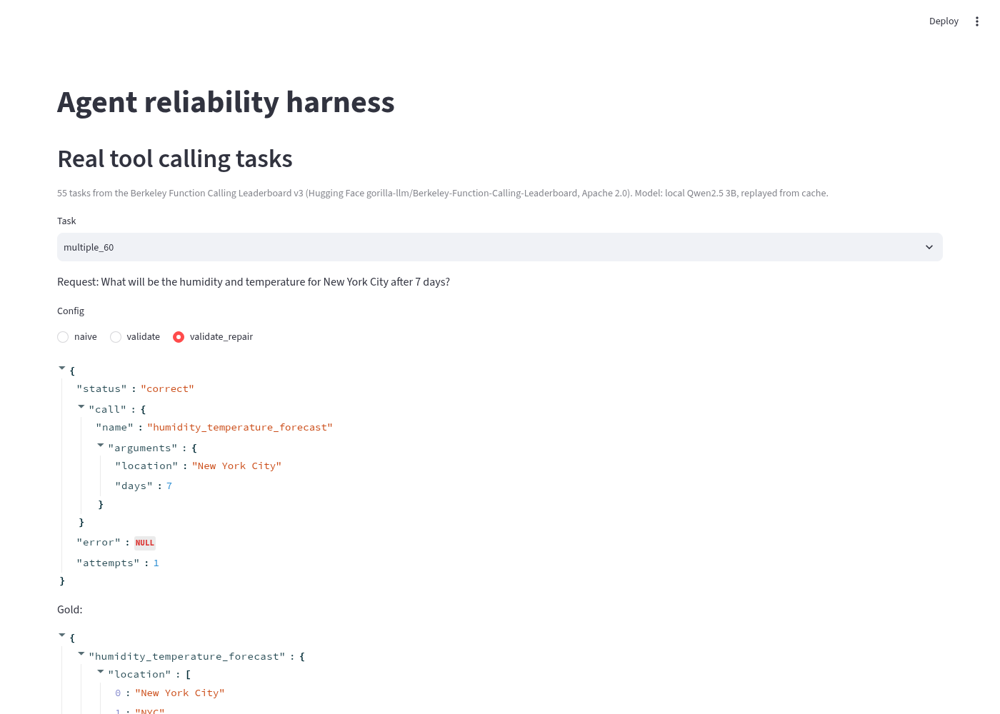

# Agent reliability harness

In client agent work the demo is easy. The hard part is a wrong tool call that looks fine. This repo measures how often a small local model makes silent tool calling mistakes on real benchmark tasks, and what a schema validator and a repair retry actually fix. A second, synthetic simulation injects tool timeouts and bad payloads. Built for Ample Insight's AI Engineer (Agentic Systems) role.

## Data (real, with sources)
| Data | Source | Licence | Use |
|---|---|---|---|
| 55 tasks sampled with a fixed seed from BFCL v3: 25 `simple` (one tool), 15 `multiple` (pick 1 of 2 to 4 tools), 15 `irrelevance` (no tool fits, the agent must abstain), with the official possible answers | Hugging Face [gorilla-llm/Berkeley-Function-Calling-Leaderboard](https://huggingface.co/datasets/gorilla-llm/Berkeley-Function-Calling-Leaderboard), files `BFCL_v3_simple.json`, `BFCL_v3_multiple.json`, `BFCL_v3_irrelevance.json` and `possible_answer/`, saved in `data/` | Apache 2.0 | Real requests, real JSON tool schemas, gold calls |
| 300 retail tasks over 60 SKUs with injected timeouts, malformed payloads and rate limits | **SYNTHETIC**, `agentrt/tools.py` | n/a | Retry and validation under tool failure, `results_simulation.json` |

## Architecture

More detail in [docs/architecture.md](docs/architecture.md).

## Design tradeoffs
| Decision | Why | Tradeoff |
|---|---|---|
| Validate against the tool's own JSON schema | Catches wrong tool names, missing args and wrong types before anything runs | Cannot catch a well formed call to the wrong tool |
| One repair retry with the exact error | Cheap fix for format mistakes | Can turn a loud failure into a silent wrong call |
| Explicit none tool for abstaining | Lets the agent say no tool fits | The 3B model rarely uses it |
| BFCL style AST check, not execution | Scores calls without running real APIs | Misses calls that are equivalent but written differently |
| Replay cache | Results, tests and UI reproduce without a model | Cache must be refreshed when prompts change |

## Results
Measured by `python3 -m agentrt.evaluate` (raw numbers in `results.json`). Local Qwen2.5 3B Instruct Q4 on CPU, temperature 0. 55 tasks is a small sample.

| Config | Slice | n | correct | silently wrong | failed loudly | model calls |
|---|---|---|---|---|---|---|
| Naive, accept first reply | all | 55 | 0.855 | 0.145 | 0.0 | 55 |
| Naive, accept first reply | simple | 25 | 1.0 | 0.0 | 0.0 | 25 |
| Naive, accept first reply | multiple | 15 | 0.933 | 0.067 | 0.0 | 15 |
| Naive, accept first reply | irrelevance | 15 | 0.533 | 0.467 | 0.0 | 15 |
| Schema validation, fail loudly | all | 55 | 0.855 | 0.127 | 0.018 | 55 |
| Schema validation, fail loudly | simple | 25 | 1.0 | 0.0 | 0.0 | 25 |
| Schema validation, fail loudly | multiple | 15 | 0.933 | 0.067 | 0.0 | 15 |
| Schema validation, fail loudly | irrelevance | 15 | 0.533 | 0.4 | 0.067 | 15 |
| Validation + 1 repair retry | all | 55 | 0.855 | 0.145 | 0.0 | 56 |
| Validation + 1 repair retry | simple | 25 | 1.0 | 0.0 | 0.0 | 25 |
| Validation + 1 repair retry | multiple | 15 | 0.933 | 0.067 | 0.0 | 15 |
| Validation + 1 repair retry | irrelevance | 15 | 0.533 | 0.467 | 0.0 | 16 |

Synthetic failure injection, `python3 -m agentrt.simulate` (`results_simulation.json`, chart `docs/simulation_chart.png`):

| Injected failure rate | Config | correct | silently wrong | failed loudly |
|---|---|---|---|---|
| 0.1 | naive (no retry, no validation) | 0.86 | 0.03 | 0.11 |
| 0.1 | validation only | 0.86 | 0.0 | 0.14 |
| 0.1 | retry 2 + validation | 0.993 | 0.0 | 0.007 |
| 0.3 | naive (no retry, no validation) | 0.663 | 0.08 | 0.257 |
| 0.3 | validation only | 0.65 | 0.0 | 0.35 |
| 0.3 | retry 2 + validation | 0.973 | 0.0 | 0.027 |



## Error analysis
* **Schema validation barely mattered on real tasks.** The model never produced a malformed call on `simple` or `multiple`. Validation caught 1 of 55 replies, and only in the irrelevance slice.
* **The real risk is acting when it should not.** On 7 of 15 irrelevance tasks the model called a tool that cannot answer the request, for example calling `calculateFinalPrice` or `hotel_search.find_hotels` with made up arguments. Those calls are well formed, so no schema check can catch them.
* **Repair made one case worse.** The only call validation rejected was "fixed" on retry into a valid but wrong call, so the silent error rate went back from 0.127 to 0.145.
* **Wrong tool choice.** `multiple_33` called `calculate_integral` with the wrong arguments for the request.
* Next fix is a relevance check before the call (a second model pass or retrieval score asking whether any tool fits), not more format checks.
* Failure cases are in `docs/failures.json`.

## Limitations
55 tasks, one small CPU model, single turn only. The failure injection part is synthetic. Next steps are BFCL multi turn and live categories, a relevance gate, and a larger model through the same backend.

## UI


## How to run
```bash
pip install -r requirements.txt
python3 -m pytest -q
python3 -m agentrt.evaluate                     # replays cached model calls
LLM=ollama LLM_MODEL=qwen2.5-3b python3 -m agentrt.evaluate   # live local model via Ollama
python3 -m agentrt.simulate                     # synthetic failure injection
streamlit run app/streamlit_app.py
```
