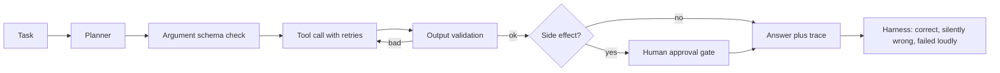
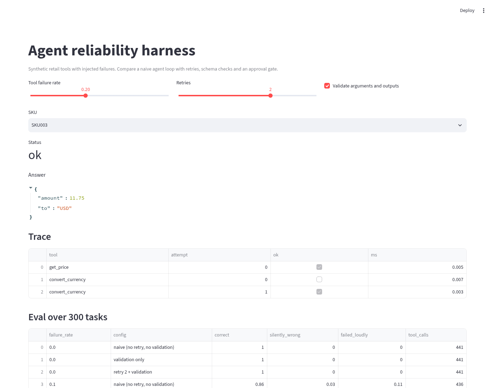
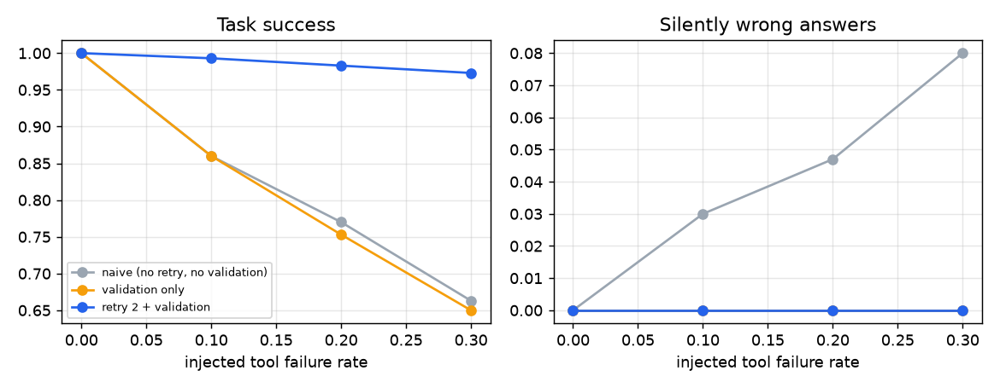

# Agent reliability harness

**Data.** SYNTHETIC tools and inventory with seeded failure injection.

## Problem
Ample Insight builds agentic AI systems for startups and Fortune 500 clients. In client work the agent demo is easy, and the hard part is what happens when tools time out, return bad payloads or hit rate limits. An agent that silently returns a wrong number is the worst outcome for a client.

## Why I built it
The Ample Insight AI Engineer (Agentic Systems) posting asks for orchestration, tool use, evaluation and observability. I built a small runtime with typed tool schemas, retries, output validation, a step budget and an approval gate on side effects, plus a harness that injects failures and counts silent errors.

## Architecture

More detail in [docs/architecture.md](docs/architecture.md).

## Screenshot


## Results
Measured by `python3 -m agentrt.evaluate` on this repo (raw numbers in `results.json`).

| Failure rate | Config | Correct | Silently wrong | Failed loudly | Tool calls |
|---|---|---|---|---|---|
| 0.0 | naive (no retry, no validation) | 1.0 | 0.0 | 0.0 | 441 |
| 0.0 | validation only | 1.0 | 0.0 | 0.0 | 441 |
| 0.0 | retry 2 + validation | 1.0 | 0.0 | 0.0 | 441 |
| 0.1 | naive (no retry, no validation) | 0.86 | 0.03 | 0.11 | 436 |
| 0.1 | validation only | 0.86 | 0.0 | 0.14 | 432 |
| 0.1 | retry 2 + validation | 0.993 | 0.0 | 0.007 | 484 |
| 0.2 | naive (no retry, no validation) | 0.77 | 0.047 | 0.183 | 429 |
| 0.2 | validation only | 0.753 | 0.0 | 0.247 | 418 |
| 0.2 | retry 2 + validation | 0.983 | 0.0 | 0.017 | 528 |
| 0.3 | naive (no retry, no validation) | 0.663 | 0.08 | 0.257 | 420 |
| 0.3 | validation only | 0.65 | 0.0 | 0.35 | 403 |
| 0.3 | retry 2 + validation | 0.973 | 0.0 | 0.027 | 583 |



## Design decisions
| Decision | Why | Tradeoff |
|---|---|---|
| Deterministic planner stand in | Isolates the reliability layer so results are reproducible | Does not measure LLM planning errors |
| Validate outputs, not just inputs | Malformed tool payloads were the source of silent errors | Needs an expected schema per tool |
| Bounded retries | Recovers transient failures | More tool calls and cost (see tool_calls column) |
| Approval gate on side effects | Reorders should never happen unreviewed | Adds a human step |
| Fail loudly over guessing | A clear failure is recoverable, a wrong answer is not | Lower raw success with validation only |

## Limitations
Tools and data are synthetic and local. The planner is rule based, so this measures the runtime, not an LLM. Failure injection is uniform, while real outages come in bursts.

## Next steps
Swap in an LLM planner with structured output and score it with the same harness, add OpenTelemetry traces, burst failure patterns, and cost per task.

## How to run
```bash
pip install -r requirements.txt
python3 -m pytest -q
python3 -m agentrt.evaluate
streamlit run app/streamlit_app.py
```
