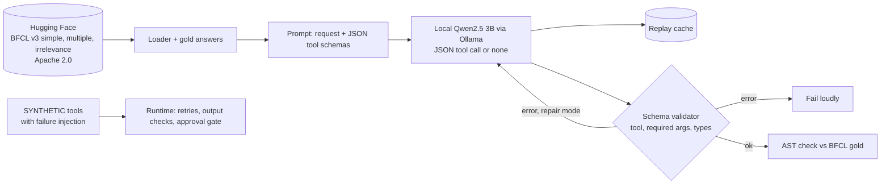

# Architecture

## Data sources

| Data | Source | Licence | Use |
|---|---|---|---|
| 55 tasks sampled with a fixed seed from BFCL v3: 25 `simple` (one tool), 15 `multiple` (pick 1 of 2 to 4 tools), 15 `irrelevance` (no tool fits, the agent must abstain), with the official possible answers | Hugging Face [gorilla-llm/Berkeley-Function-Calling-Leaderboard](https://huggingface.co/datasets/gorilla-llm/Berkeley-Function-Calling-Leaderboard), files `BFCL_v3_simple.json`, `BFCL_v3_multiple.json`, `BFCL_v3_irrelevance.json` and `possible_answer/`, saved in `data/` | Apache 2.0 | Real requests, real JSON tool schemas, gold calls |
| 300 retail tasks over 60 SKUs with injected timeouts, malformed payloads and rate limits | **SYNTHETIC**, `agentrt/tools.py` | n/a | Retry and validation under tool failure, `results_simulation.json` |

## Design tradeoffs

| Decision | Why | Tradeoff |
|---|---|---|
| Validate against the tool's own JSON schema | Catches wrong tool names, missing args and wrong types before anything runs | Cannot catch a well formed call to the wrong tool |
| One repair retry with the exact error | Cheap fix for format mistakes | Can turn a loud failure into a silent wrong call |
| Explicit none tool for abstaining | Lets the agent say no tool fits | The 3B model rarely uses it |
| BFCL style AST check, not execution | Scores calls without running real APIs | Misses calls that are equivalent but written differently |
| Replay cache | Results, tests and UI reproduce without a model | Cache must be refreshed when prompts change |

## Limitations

55 tasks, one small CPU model, single turn only. The failure injection part is synthetic. Next steps are BFCL multi turn and live categories, a relevance gate, and a larger model through the same backend.
