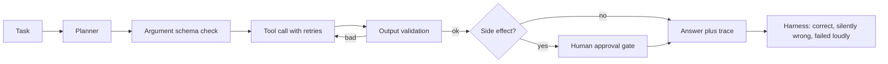

# Architecture

`agentrt/tools.py` has 4 tools over a synthetic inventory with seeded failure injection (timeouts, malformed payloads, rate limits). `agentrt/runtime.py` is the reliability layer around a rule planner that stands in for an LLM planner. `agentrt/evaluate.py` runs 300 tasks at failure rates from 0 to 0.3 for 3 configurations.

## Design decisions

| Decision | Why | Tradeoff |
|---|---|---|
| Deterministic planner stand in | Isolates the reliability layer so results are reproducible | Does not measure LLM planning errors |
| Validate outputs, not just inputs | Malformed tool payloads were the source of silent errors | Needs an expected schema per tool |
| Bounded retries | Recovers transient failures | More tool calls and cost (see tool_calls column) |
| Approval gate on side effects | Reorders should never happen unreviewed | Adds a human step |
| Fail loudly over guessing | A clear failure is recoverable, a wrong answer is not | Lower raw success with validation only |
